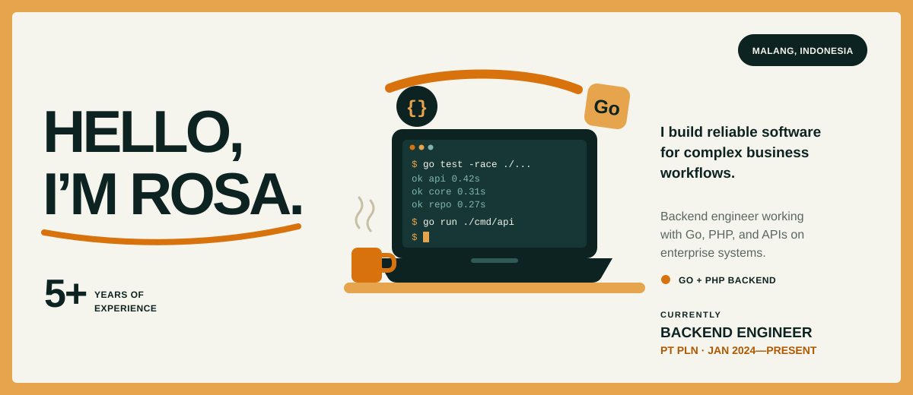
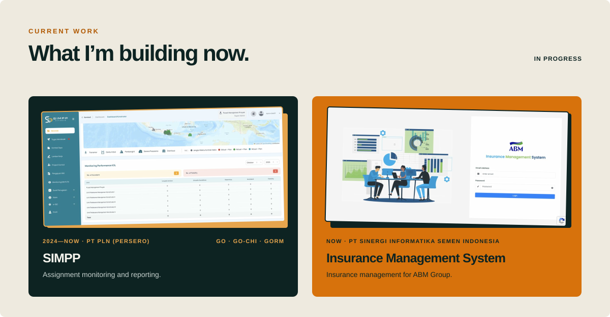
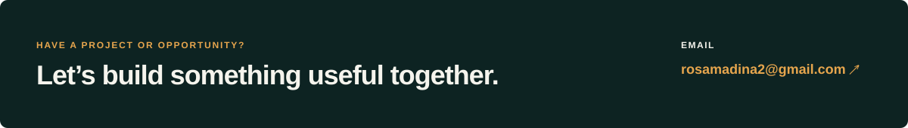

<div align="center">



<br/>

<a href="https://portfolio-two-khaki-83.vercel.app/"></a>
<a href="https://www.linkedin.com/in/rosa-nur-madinah"></a>
<a href="mailto:rosamadina2@gmail.com"></a>

</div>

## About

I'm **Rosa**, a backend engineer based in **Malang, Indonesia**. I build reliable software for complex business workflows: clean APIs, solid databases, and integrations that keep enterprise systems running. 5+ years across energy, procurement, finance, and operations.

## A little more about me...

```go
package main

type Developer struct {
	Name         string
	Role         string
	Location     string
	Languages    []string
	AskMeAbout   []string
	Stack        map[string][]string
	CurrentFocus string
}

var rosa = Developer{
	Name:      "Rosa Nur Madinah",
	Role:      "Backend Engineer",
	Location:  "Malang, Indonesia",
	Languages: []string{"Go", "PHP", "JavaScript"},
	AskMeAbout: []string{
		"Go backend services",
		"API design and integration",
		"Laravel and CodeIgniter",
		"enterprise workflows",
	},
	Stack: map[string][]string{
		"backend":  {"go-chi", "GORM", "Laravel", "CodeIgniter"},
		"frontend": {"Vue.js", "HTML", "CSS"},
		"data":     {"PostgreSQL", "MySQL", "Redis", "MinIO", "RabbitMQ"},
		"delivery": {"Git", "GitHub Actions", "Docker", "SonarQube"},
	},
	CurrentFocus: "SIMPP at PT PLN and an insurance system at PT Sinergi Informatika Semen Indonesia",
}
```

<br/>

<div align="center">



</div>

> Most of my work lives in private company repositories, so the projects above are summarized rather than linked.

## GitHub activity

<div align="center">


</div>

## How I work

| Clear logic | Honest collaboration | Reliable delivery |
|---|---|---|
| Complex business rules turned into readable code and well-defined APIs. | Close work with analysts, frontend, and backend teammates, with risks raised early. | Thorough debugging, clean code practices, and changes that stay maintainable. |

<br/>

<div align="center">

<a href="mailto:rosamadina2@gmail.com"></a>

</div>
